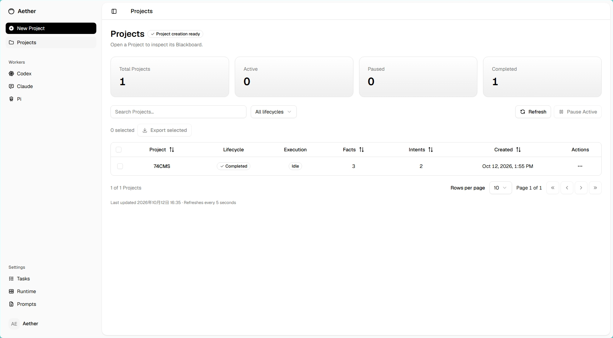

<h1 align="center">Aether</h1>

<p align="center">意图工程和第一性原理的渗透AGENT。</p>

<p align="center">
  
  
  
  
</p>

<p align="center">
  <a href="README.md">English</a> ·
  <a href="README_CN.md">简体中文</a> ·
  <a href="INSTALL_CN.md">安装与部署</a>
</p>



## 目录

- [功能](#功能)
- [快速开始](#快速开始)
- [运行方式](#运行方式)
- [源码结构](#源码结构)
- [开发验证](#开发验证)
- [致谢](#致谢)

## 功能

- **Worker 运行环境：**支持 Claude Code、Codex 和 Pi，分别配置模型提供方和凭据。
- **执行历史：**通过 SQLite 持久化项目状态和执行记录。
- **运行设置：**可配置并发、任务超时、重试策略、提示词组和项目容器。
- **人工控制：**支持暂停、恢复、基于证据完成、重新打开、历史回放和项目快照导出。
- **配置版本：**新项目使用已保存的设置，已有项目保留其绑定的配置版本。
- **原生部署：**Next.js 界面嵌入 Go 二进制，Server 与 Dispatcher 可合并或分离运行。

## 快速开始

构建需要 Go 1.26.4 或更新版本、Node.js 20.9 或更新版本、npm、Bash 和 Git。运行 Worker 还需要可访问的 Docker daemon、兼容的 Worker 镜像及模型提供方凭据。目前验证过的部署环境为 Linux。

```bash
git clone https://github.com/C1ph3rX13/Aether.git
cd Aether
./install.sh
export PATH="$HOME/.local/bin:$PATH"
aether --version
docker pull ghcr.io/c1ph3rx13/aether-worker:latest
```

安装脚本会构建前后端，并安装到 `~/.local/bin/aether`。如需更改位置，可执行 `./install.sh /path/to/bin`，目标目录须可写。当前应用版本为 **0.1.0**。

按[首次启动指南](INSTALL_CN.md#首次启动)创建部署配置后，在仓库根目录启动 Aether：

```bash
aether run --deployment "$PWD/configs/bootstrap-deployment.toml"
```

> [!TIP]
> **推荐使用 `aether run` 启动。**该命令会在同一进程中启动 Server 和 Dispatcher。

打开 [http://127.0.0.1:8000](http://127.0.0.1:8000)，[配置首个 Worker](INSTALL_CN.md#配置首个-worker)，然后通过 **Projects → New Project** 创建项目。

## 运行方式

所有运行方式都必须显式指定 TOML 部署配置，可参考[内置示例](configs/bootstrap-deployment.example.toml)。

| 命令 | 职责 |
| --- | --- |
| `aether run -d deployment.toml` | **推荐方式。**在同一进程中启动 Server 和 Dispatcher。 |
| `aether serve -d deployment.toml` | 浏览器界面、HTTP API 和 SQLite，不访问 Docker。 |
| `aether dispatch -d deployment.toml` | 调度与 Docker Worker 执行，通过 HTTP 连接 Server。 |

部署配置包含部署身份、监听地址、数据库路径及 Dispatcher 连接参数。Worker 凭据、模型、容器设置和调度策略通过网页配置并持久化到 SQLite。

## 源码结构

| 路径 | 内容 |
| --- | --- |
| `cmd/aether/` | 原生 CLI 和运行组件装配。 |
| `internal/` | 控制平面、配置、项目状态、调度、Worker 适配器及数据库迁移。 |
| `internal/worker/prompts/` | 程序运行所需的内置提示词。 |
| `web/` | Next.js 前端和组件测试。 |
| `configs/` | 部署配置示例。 |
| `test/` | 验收、端到端及浏览器场景代码。 |
| `install.sh` | 源码构建与原生安装脚本。 |

## 开发验证

```bash
go test ./cmd/... ./internal/... ./test/...
go vet ./cmd/... ./internal/... ./test/...

cd web
npm ci
npm run build
npm run lint
npm run typecheck
npm test
```

竞态检查、手动构建及真实 Docker 容器测试说明见 [INSTALL_CN.md](INSTALL_CN.md#验证)。

## 致谢

感谢 [Cairn](https://github.com/oritera/Cairn) 项目及其维护者、贡献者对开源社区的贡献。
